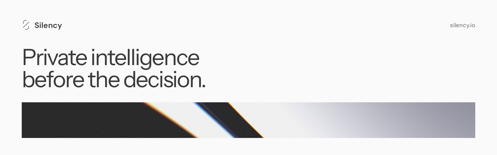

<a href="https://silency.io/?utm_source=github&utm_medium=profile&utm_campaign=readme">
  <picture>
    <source media="(prefers-color-scheme: dark)" srcset="assets/banner-dark.png">
    <source media="(prefers-color-scheme: light)" srcset="assets/banner-light.png">
    
  </picture>
</a>

 

Silency is a private intelligence practice. Before you act on what is said in public about a company, a market or a partner, we read it a second time and show you what it rests on, with the evidence attached.

The work itself happens at **[silency.io](https://silency.io/?utm_source=github&utm_medium=profile&utm_campaign=readme)**.

[Request a briefing](https://silency.io/?utm_source=github&utm_medium=profile&utm_campaign=readme#contact) &nbsp;·&nbsp;
[How it works](https://silency.io/?utm_source=github&utm_medium=profile&utm_campaign=readme#method) &nbsp;·&nbsp;
[Readings](https://silency.io/readings/?utm_source=github&utm_medium=profile&utm_campaign=readme) &nbsp;·&nbsp;
[Security](https://silency.io/security/?utm_source=github&utm_medium=profile&utm_campaign=readme) &nbsp;·&nbsp;
[Library](https://silency.io/library/?utm_source=github&utm_medium=profile&utm_campaign=readme)

 

### What we share here

A practice that holds other people's questions has to protect them. The code we publish comes from that work, grouped by the problem it addresses. It carries no client material and describes no part of our own systems.

 

**Security**
 Treating every input as hostile, and reasoning about threats as likelihoods.

| | |
|:--|:--|
| [probabilistic-threat-modeling](https://github.com/silencytechnologies/probabilistic-threat-modeling) | How to reason about threats when the answer is a likelihood. |

**AI and language models**
 Containing automated actors and measuring the risk they carry.

| | |
|:--|:--|
| [ai-trust-boundary-patterns](https://github.com/silencytechnologies/ai-trust-boundary-patterns) | Trust boundaries as a property of the system around an AI agent. |
| [conformal-margin](https://github.com/silencytechnologies/conformal-margin) | Fleet-level monitoring of AI agents with a stated false-positive rate, through conformal prediction. |

<!-- Privacy: add this group when the first privacy repository is public.
**Privacy**
 Keeping what a client sends out of reach, and out of the record.

| | |
|:--|:--|
-->

 

### Using this code

The code is under the Silency Technologies Non-Commercial License. A person may use it for personal, educational or non-commercial work. A company may not use it in any way, internal tools and evaluation included, without our written permission. Anything the license does not expressly permit is prohibited. The full text is in each repository's LICENSE file; to ask for a business licence, [write to us](https://silency.io/?utm_source=github&utm_medium=profile&utm_campaign=readme#contact).

 

Silency. Quietly observing. &nbsp;·&nbsp; [silency.io](https://silency.io/?utm_source=github&utm_medium=profile&utm_campaign=readme)
